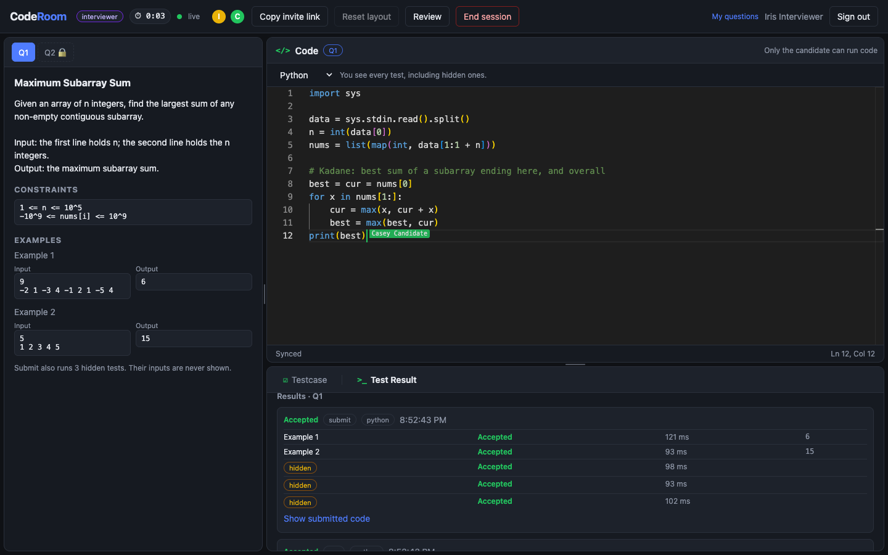
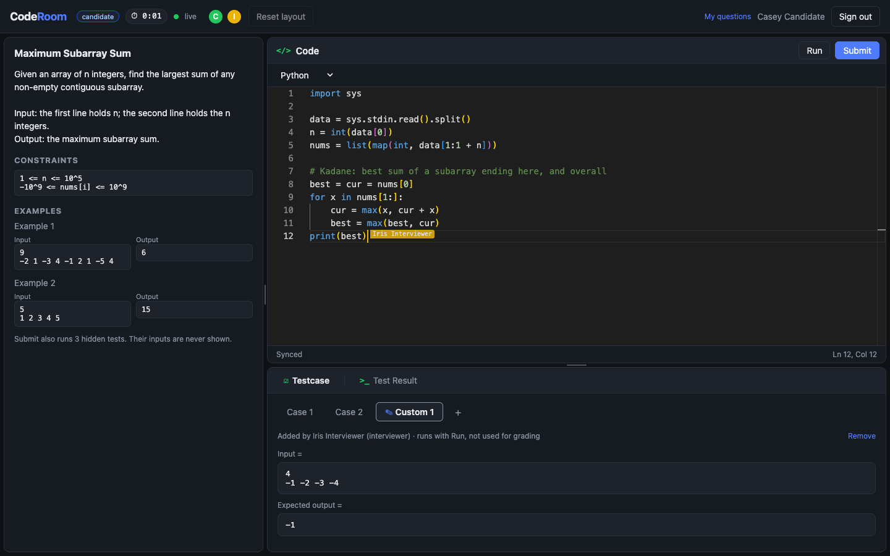
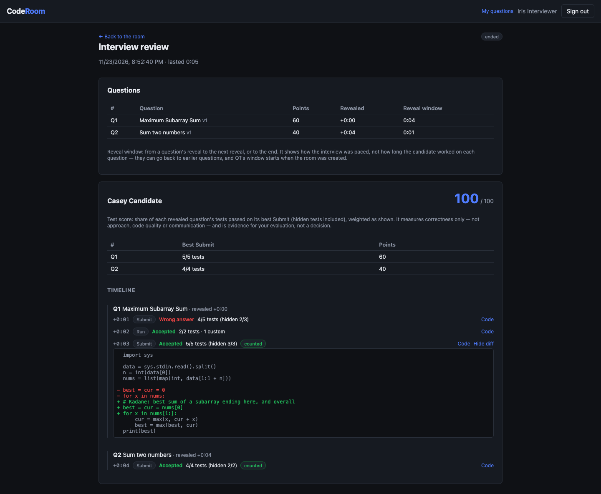
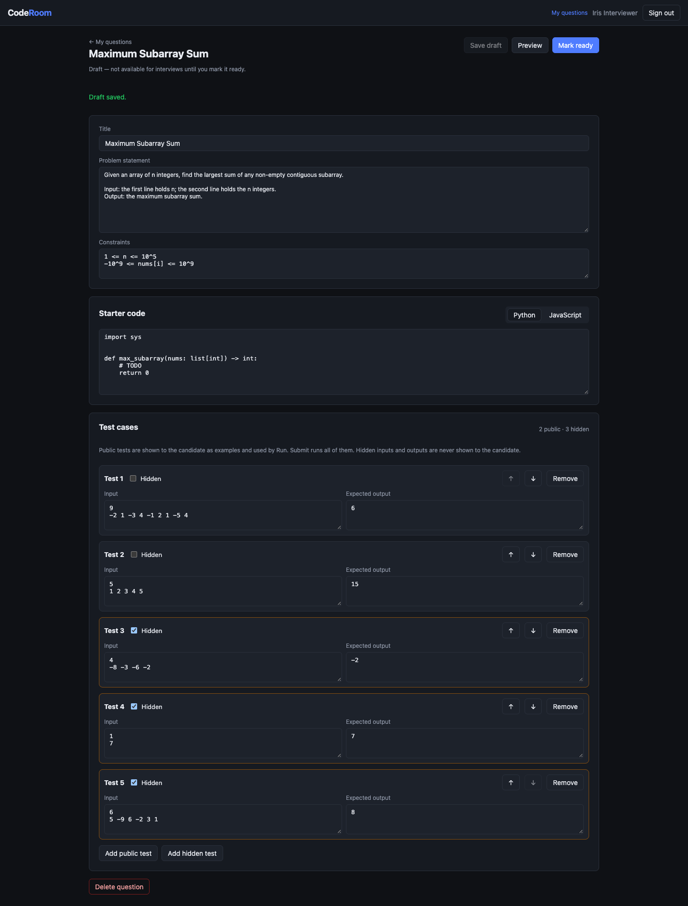
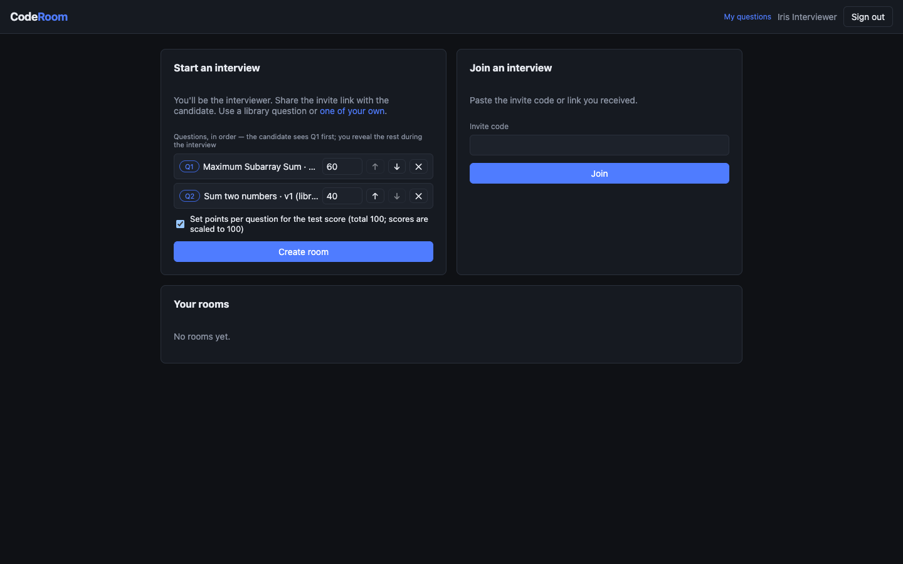
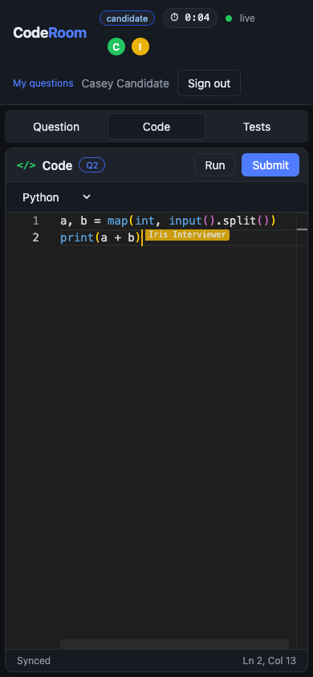
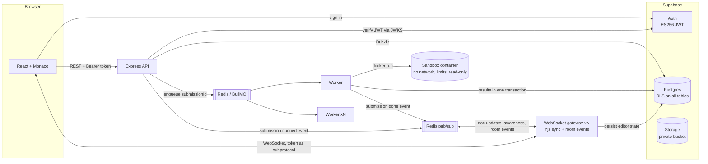

# CodeRoom

**A live technical-interview platform where candidate code runs in isolated sandboxes and AI assists the interviewer — without ever deciding who gets hired.**

Interviewer and candidate share a room. The candidate writes code; every run goes through a queue to a disposable, locked-down Docker container and comes back with per-test verdicts. Hidden test cases never leave the server. An AI copilot (in progress) helps the interviewer prepare questions, ask follow-ups and summarize evidence against a rubric.

> **Status:** a working interview product end to end — sign in, create a room, share an invite link, edit code together in real time, run/submit against sandboxed tests and see role-aware results live. Tested across multiple API instances. AI copilot, rubric and replay are next — see [Roadmap](#roadmap).

---

## Screenshots

**Interviewer view during a live interview:** the question, the shared editor with the candidate's named cursor, and every test result, hidden ones included. Run/Submit belong to the candidate; the interviewer reveals the next question (Q2 🔒) when ready.



<table>
  <tr>
    <td width="50%" valign="top">
      <b>Candidate view</b>: an edge case the interviewer added appears as <i>Custom 1</i> for both sides; Run tries it, Submit never grades it.<br><br>
      
    </td>
    <td width="50%" valign="top">
      <b>Post-interview review</b>: a test score out of 100 (evidence, not a decision), the per-question breakdown, and a timeline with the diff that fixed the bug.<br><br>
      
    </td>
  </tr>
  <tr>
    <td width="50%" valign="top">
      <b>Question authoring</b>: statement, constraints, starter code, public and hidden tests; published versions are immutable.<br><br>
      
    </td>
    <td width="50%" valign="top">
      <b>Starting an interview</b>: ordered questions with optional points for the score. <b>On a phone</b> the room becomes tabs.<br><br>
      <br><br>
      
    </td>
  </tr>
</table>

<sub>Generated from a real interview driven through the UI: <code>pnpm screenshots</code> (local stack running) re-creates every image in <code>docs/screenshots/</code>.</sub>

---

## Highlights

- **Untrusted code never touches the API server.** The API validates, stores and enqueues; separate workers execute.
- **Per-run Docker sandbox** with no network, memory/CPU/PID limits, read-only filesystem, dropped capabilities, non-root user and a hard timeout. An infinite loop is killed; a memory bomb is stopped; outbound HTTP fails.
- **Hidden tests stay hidden** — enforced three ways: a candidate-only serializer, a database `CHECK` constraint that refuses to store hidden-test output, and Row Level Security that blocks direct table access via Supabase's public API.
- **Per-room roles, one candidate per room.** The same user can interview in one room and be a candidate in another; every request is checked against room membership. Each room has exactly one interviewer and one candidate: the first person to open the invite link takes the seat, anyone else gets `409` and no access — enforced by a unique index, so simultaneous joins can't both get in ([ADR 0012](docs/decisions/0012-one-candidate-per-room.md)).
- **Horizontally scalable execution.** Stateless BullMQ workers; add processes to add throughput. Retries are idempotent.
- **Collaborative editing that scales out.** Yjs (CRDT) over our own WebSocket gateway; interviewer and candidate can be connected to *different* API instances and stay in sync via Redis pub/sub. Concurrent edits converge; the document survives everyone leaving.
- **Live, role-aware results.** When the worker finishes, every connected participant gets the submission pushed over WebSocket — candidates the redacted view, interviewers the full one.
- **Interviewers author their own questions — with versioning.** Statement, constraints, per-language starter code, public and hidden tests (add, edit, reorder, hide, remove), draft → preview → "mark ready". Each ready version is immutable (enforced by database triggers) and every room pins the version it started with, so editing a question never changes a past or running interview ([ADR 0007](docs/decisions/0007-immutable-question-versions.md)).
- **Multi-question interviews.** Pick up to five questions in order; the candidate sees Q1, and the interviewer reveals the rest one at a time (strictly in order). Unrevealed questions never reach the candidate — not their content, not even how many there are. Each question has its own code buffer and is graded against its own pinned version, enforced by a composite foreign key ([ADR 0009](docs/decisions/0009-multi-question-rooms.md)).
- **Shared custom test cases and an interview timer.** Interviewer and candidate can both add test cases (input + optional expected output) to the question they're on; both see them instantly, and **Run** tries them alongside the examples. They're never graded — Submit uses only the question's tests — and the top bar shows both participants how long the interview has been running ([ADR 0010](docs/decisions/0010-custom-test-cases-and-timer.md)).
- **Post-interview review with a test score.** The interviewer gets a review page per room: for each candidate a test score out of 100 (share of each revealed question's tests passed on its best Submit, hidden tests included, weighted by optional per-question points), each question's reveal window (pacing), and a timeline of every run and submission with its code and a diff against the previous Submit. The score is labelled as evidence — correctness only — not a decision ([ADR 0011](docs/decisions/0011-interview-review-and-test-score.md)). The interviewer's room list shows each room's candidate (name and email) in aligned columns, with search — never on a candidate's own list; scores stay on the review page ([ADR 0013](docs/decisions/0013-room-list-candidates.md)).
- **A real interview UI.** Invite links, a shared Monaco editor with named live cursors and presence, a synced language picker, Run/Submit for the candidate, and a results panel where the interviewer also sees hidden tests and the exact submitted code. The question sits beside the code editor, which is stacked over a **Testcase / Test Result** panel (example cases one at a time; the selected question's runs). Both dividers resize by drag or keyboard, are remembered per browser (never synced to the other participant), and the panels become tabs on narrow screens ([ADR 0008](docs/decisions/0008-room-layout-own-splitter.md)).
- **Every stack choice is documented** in [Architecture Decision Records](docs/decisions/README.md).

## Architecture



### Submission flow

1. Candidate calls `POST /submissions` with a Supabase access token.
2. API verifies the token (JWKS, issuer, audience), checks the user is a **candidate in that room**, checks the room is open and the code size, then inserts the submission. The question comes from the room, not the client.
3. API enqueues a job containing **only the submission id** and returns `202 Accepted`.
4. A worker loads the submission and its test cases, then runs each test in a fresh container with stdin input and a wall-clock timeout.
5. Verdicts (`accepted`, `wrong_answer`, `time_limit_exceeded`, `memory_limit_exceeded`, `runtime_error`, …) and the overall result are written in **one transaction**, then announced on Redis pub/sub.
6. Every gateway instance with participants in that room loads the result once and pushes it over WebSocket: a **candidate view** (public results + hidden pass count) or an **interviewer view** (everything), based on each participant's role. `GET /submissions/:id` returns the same role-based views.

### Realtime flow

1. The client opens `ws://<api>/yjs/<roomId>` with the access token as a WebSocket **subprotocol** (`["coderoom.v1", token]`) — tokens never appear in URLs or access logs.
2. Before the upgrade completes, the gateway verifies the JWT, checks the user is a participant and the room is open. Rejections are plain HTTP `401/403/404/410`; no socket is created.
3. The gateway loads the room's Yjs document from Postgres (or memory) and speaks the standard y-websocket protocol, so stock `y-websocket` / `y-monaco` clients work.
4. Local edits are broadcast to this instance's clients **and** published to Redis (`yjs:<roomId>`), tagged with the instance id; other instances apply them and forward to their clients. A newly loaded instance asks peers for anything it's missing.
5. State is persisted 2 s after the last edit and when the last client leaves. Sockets close with `4401` when the token expires, so the client reconnects with a fresh one.

## Tech stack

| Layer | Choice | Why |
|---|---|---|
| Frontend | React, TypeScript, Vite, React Router | Small SPA; the editor route is lazy-loaded (initial bundle ~80 KB gzipped) |
| Editor | Monaco (bundled, no CDN) + `y-monaco` | VS Code's editor; one Monaco instance shared with the Yjs binding; live remote cursors |
| Browser auth | `@supabase/auth-js` only | The browser only signs in — it never queries tables, so the full Supabase client isn't needed ([ADR 0006](docs/decisions/0006-rls-deny-all-server-side-access.md)) |
| API | Node.js, Express, TypeScript | Thin validate → persist → enqueue layer |
| Database | Postgres (Supabase) + Drizzle ORM | Relational domain, FKs and constraints enforce invariants — [ADR 0001](docs/decisions/0001-postgres-over-mongodb.md), [0003](docs/decisions/0003-drizzle-orm.md) |
| Auth / Storage | Supabase Auth, Supabase Storage | Commodity concerns, managed — [ADR 0002](docs/decisions/0002-supabase-for-auth-storage-postgres.md) |
| Queue | Redis + BullMQ | Retries, back-pressure, concurrency; Redis also does pub/sub — [ADR 0004](docs/decisions/0004-queue-and-docker-sandbox.md) |
| Execution | Docker (per-run containers) | Isolation with measurable limits — [ADR 0004](docs/decisions/0004-queue-and-docker-sandbox.md) |
| Realtime | Yjs + `ws` gateway, Redis pub/sub fan-out | CRDT merging, auth before upgrade, scales across instances — [ADR 0005](docs/decisions/0005-yjs-over-own-websocket.md) |
| Validation | zod (shared package) | One schema for API, worker and DB enums |
| Testing | Vitest + end-to-end smoke scripts | Unit-tests every sandbox control; smoke tests hit the real stack, including two API instances |

**Deliberately not used:** MongoDB, a separate S3/MinIO, Supabase Realtime, browser-side table queries ([ADR 0006](docs/decisions/0006-rls-deny-all-server-side-access.md)).

## Security model

| Threat | Control |
|---|---|
| Malicious code crashes or hijacks the server | Code never runs in the API; workers execute in disposable containers |
| Infinite loop / CPU exhaustion | `--cpus` quota + wall-clock timeout → `docker kill` |
| Memory bomb | `--memory` with equal `--memory-swap` (no swap) |
| Fork bomb | `--pids-limit 64` |
| Data exfiltration / calling out | `--network none` |
| Tampering with the image or host | `--read-only`, `noexec` tmpfs, `--cap-drop ALL`, `no-new-privileges`, non-root user, read-only code mount |
| Candidate reads hidden tests | Candidate serializer + DB `CHECK` constraint + RLS deny-all on Supabase REST |
| Forged identity / role | JWT verified against Supabase JWKS; roles looked up per room server-side, never trusted from the client |
| Probing other rooms | Non-participants get `403` whether or not the room exists |
| Unauthorized WebSocket access | Auth + room membership checked before the upgrade; token sent as subprotocol (not in URL); socket closed at token expiry |
| Oversized / malformed realtime messages | 1 MB max frame; invalid Yjs messages close the socket; dead connections dropped by heartbeat |
| Submission flooding | Per-user rate limit in Redis (10/min across all API instances), `429` + `Retry-After` |
| Editing after the interview ended | Server drops document writes on already-open sockets; enforced on every instance via the room bus |

## Reliability

| Failure | What happens |
|---|---|
| Redis/queue unavailable right after the submission row is written | API still answers `202`; the worker's **outbox sweeper** re-enqueues `queued` rows older than 30 s. Delayed, never lost. |
| Client retries a submit after a lost response | The browser reuses the same `Idempotency-Key` for the same action; the key is stored on the submission row (unique per user, same `INSERT`), so the retry returns the original. Concurrent duplicates collide on the index; a reused key with a different body is `422` |
| Duplicate job for the same submission | `jobId = submissionId` dedupes in BullMQ; the worker skips already-finished submissions |
| Worker crashes mid-job | BullMQ stalled-job detection re-runs it; results are written in one transaction, previous partial results deleted |
| Postgres write of the editor document fails | Change stays `dirty`; saves retry with backoff. Unload waits for any in-flight save first. If the final retries fail, edits are **retained in memory** with background retries for as long as the process lives, plus a **best-effort** Redis copy (7-day TTL) that the next load of the room merges back. Edits can still be lost if the process exits while Postgres is down *and* the Redis copy is missing (spill failed, Redis lost it, or 7 days passed) |
| Two instances save the same room (one missed an update, or both make the very first save) | Every save runs under a per-room Postgres advisory lock and merges with the stored snapshot instead of overwriting it, so a save can't remove content another instance saved |
| Last user leaves while a save is in flight | Unload awaits that save; if it fails, the doc is saved again before it's destroyed |
| `room:closed` publish fails, or a gateway misses it | Each gateway reconciles room status from Postgres every 5 s and enforces it on open sockets |
| `room:question_revealed` publish fails, or a gateway misses it | The same reconciler re-reads how many questions are revealed; connected clients are told within ~5 s without reconnecting. Each reveal is announced once (gateways forward only an increased count). If the room ends before that, clients re-fetch the room on `room:closed` and still get the final question list |
| Candidate submits at the moment the session ends | The open-room check and the insert run in one transaction holding a share lock on the room row (concurrent submissions don't block each other; closing does) — a submission is accepted before the close or refused after it, never stored in an ended room |
| Interviewer reveals a question while ending the session | Reveal locks the room row (`FOR UPDATE`) and checks the status in the same transaction; closing updates that row, so the two serialize — no question is ever revealed in an ended room |
| Browser loses its events socket while a result is published | On every reconnect the client re-fetches history and **merges** it — a submission never moves backwards, so a slow response can't undo a newer result |
| A gateway instance holds unsaved edits when another loads the room | The new instance asks peers for missing updates (state-vector sync over Redis) |

## Getting started

### Prerequisites
- Node.js 22+ recommended (20 works for the backend; see note below)
- pnpm 9 (`corepack enable`)
- Docker Desktop (running)

### Setup

```bash
git clone https://github.com/<your-username>/coderoom.git
cd coderoom
pnpm install
cp .env.example .env
```

Start the local services:

```bash
pnpm db:start        # local Supabase: Postgres, Auth, Storage; applies migrations + seed
pnpm infra:up        # Redis
pnpm sandbox:build   # Python + JavaScript runner images
```

Copy the **publishable key** printed by `pnpm db:start` (or `pnpm exec supabase status`) into `VITE_SUPABASE_PUBLISHABLE_KEY` in `.env`.

Run everything:

```bash
pnpm dev             # web :5173, api :4000, worker
```

Open http://localhost:5173, create an account and start a room, then use **Copy invite link**. Each browser tab keeps its own session, so you can paste the link into a second tab and sign up as the candidate to try both sides at once.

Verify end to end (with `pnpm dev` running, in another terminal):

```bash
pnpm smoke
pnpm smoke:realtime
pnpm e2e
```

To prove cross-instance sync, start a second API on another port and point the candidate at it:

```bash
PORT=4001 pnpm --filter @coderoom/api dev
SMOKE_API_URL_2=http://localhost:4001 pnpm smoke:realtime
```

### Scripts

| Command | What it does |
|---|---|
| `pnpm dev` | Build shared libs, then run web, API and worker in watch mode |
| `pnpm test` | Unit tests (Vitest) |
| `pnpm typecheck` / `pnpm build` | Type-check / build all packages |
| `pnpm smoke` | End-to-end checks against the running stack (API + sandbox, question authoring/versioning, multi-question rooms) |
| `pnpm smoke:realtime` | Realtime checks: upgrade auth, sync latency, convergence, live results, persistence |
| `pnpm e2e` | Playwright browser tests of the interviewer/candidate flow (local stack only) |
| `pnpm screenshots` | Re-creates the README screenshots from a real interview driven through the UI (local stack only) |
| `pnpm db:start` / `db:stop` | Start / stop local Supabase |
| `pnpm db:reset` | Wipe local DB, reapply migrations and seed |
| `pnpm db:generate` | Generate a SQL migration from `packages/db/src/schema.ts` |
| `pnpm infra:up` / `infra:down` | Start / stop Redis |
| `pnpm sandbox:build` | Build language runner images |

> **Node note:** `@supabase/supabase-js` requires Node 22+ when used from Node. The backend doesn't depend on it; the smoke test uses `@supabase/auth-js`.

## API

All endpoints except `/health` require `Authorization: Bearer <supabase access token>`.

| Method | Path | Who | Description |
|---|---|---|---|
| `GET` | `/health` | — | Postgres + Redis status |
| `GET` | `/questions` | any user | Questions you can interview with: your ready ones + the shared library (with version) |
| `GET` | `/questions/mine` | any user | Your questions with status (`draft` / `ready` vN / unpublished changes) |
| `POST` | `/questions` | any user | Create a question (starts as a draft) |
| `GET` | `/questions/:id` | owner | Editor view: current draft, latest ready version, version list, rooms using it |
| `PUT` | `/questions/:id/draft` | owner | Save the whole draft (statement, constraints, starter code, ordered tests) with `baseRevision`. Creates a new draft if the question is ready. `409` if the draft changed since (stale tab) |
| `POST` | `/questions/:id/publish` | owner | `{ revision }` → next immutable version. `400` with `problems` if incomplete, `409` if the draft changed since |
| `DELETE` | `/questions/:id/draft` | owner | `{ revision }` → discard unpublished changes (`409` if stale) |
| `GET` | `/questions/:id/preview?of=draft\|latest` | owner | Exactly the candidate's view (public tests only) |
| `DELETE` | `/questions/:id` | owner | `{ revision }` → delete a never-ready question (`409` once ready or if stale) |
| `GET` | `/rooms` | any user | Rooms the caller participates in (50 most recent). Rooms you interview include `candidates: [{ name, email }]`; candidate rows never do |
| `GET` | `/rooms/:id/review` | interviewer | Per candidate: test score + breakdown, reveal window per question, every run/submission with code (ADR 0011) |
| `POST` | `/rooms` | any user | `{ questionIds, questionPoints? }` (1–5, ordered; your own or library questions; points 1–100 each, default equal). **Pins each question's latest ready version**; Q1 is revealed. Caller becomes interviewer |
| `POST` | `/rooms/join` | any user | Join with invite code as the room's candidate; the same candidate can rejoin, anyone else gets `409` `{ conflict: "room_full" }` (one candidate per room); the interviewer's own link returns `{ role: "interviewer" }` |
| `GET` | `/rooms/:id` | participant | Questions (pinned versions, public tests only), caller's role, invite code for the interviewer. Candidates get only revealed questions |
| `POST` | `/rooms/:id/questions/:roomQuestionId/reveal` | interviewer | Reveal the next question to the candidate (in order; repeating is a no-op; `409` if out of order) |
| `GET` | `/rooms/:id/submissions` | participant | History, newest first, in the caller's role view (candidates see only their own) |
| `POST` | `/rooms/:id/close` | interviewer | End the session: room becomes read-only everywhere, including already-open sockets |
| `POST` | `/submissions` | candidate | `{ roomId, roomQuestionId, language, mode: "run" \| "submit", code, customCases? }` (a revealed question; `404` otherwise). `customCases` (≤ 10, ≤ 10 KB each) only with Run → `202 { submissionId }`. Optional `Idempotency-Key` header; 10/min per user (`429` + `Retry-After`) |
| `GET` | `/submissions/:id` | participant | Candidate view or interviewer view, by role |

### WebSocket

Both require the subprotocols `["coderoom.v1", <access token>]` and room membership.

| Path | Protocol | Description |
|---|---|---|
| `/yjs/:roomId` | y-websocket (binary) | Shared editor. Use `doc.getText("code")`. Awareness carries cursors/names |
| `/rooms/:roomId/events` | JSON, server → client | `ready`, `submission:queued`, `submission:result` (role-specific view), `room:question_revealed`, `room:closed`. Fire-and-forget: clients re-fetch history and the room over REST on every (re)connect |

Ended rooms still accept WebSocket connections (to view the final code), but the server drops every document write.

## Testing

- **Unit tests** — every sandbox `docker run` flag, verdict mapping, the candidate/interviewer serializers (hidden test ids never appear in the candidate view), the document manager against a fake database (failed saves are retried, saves never overlap, unload waits for an in-flight save, edits are retained and recovered — even by a new process — when the DB is down, read-only rooms drop writes), and the browser's history merge (a result is never rolled back by an older snapshot).
- **Smoke test** (`pnpm smoke`) — signs up real Supabase users and checks 25 behaviours against the running stack, then `questions-smoke.ts` checks 40 more for authoring, ownership, versioning and two-tab conflicts (including a draft being replaced while an old tab is open) (an interview on v1 keeps showing and grading v1 after v2 is ready; the DB rejects edits to a published version), and `rooms-smoke.ts` checks multi-question rooms: candidates never receive unrevealed questions or submit to them, reveals happen only in order (also under racing requests), each question is graded on its own version, and the DB rejects a submission pinned to the wrong version. Latest local run of the first part:

| Case | Result |
|---|---|
| Correct solution (submit) | `accepted`, hidden 2/2 — ~0.5 s |
| Wrong answer | `wrong_answer`, hidden 0/2 |
| Exception | `runtime_error` |
| `while True: pass` | `time_limit_exceeded` (container killed) |
| Memory bomb | `memory_limit_exceeded` |
| Outbound HTTP | blocked → `runtime_error` |
| No / bad token | `401` |
| Outsider / interviewer submitting | `403` |
| Supabase REST read of `test_cases` | 0 rows (RLS) |
| Leftover containers | 0 |
| Same `Idempotency-Key` sent twice | one submission, second response marked `Idempotent-Replayed` |
| Two concurrent requests with one key | both get the same submission; exactly one row in Postgres |
| Same key, different code | `422` |
| 11 submit attempts in a minute | 11th → `429` with `Retry-After` |
| Queued row with no job (simulated enqueue failure) | recovered by the outbox sweeper and graded `accepted` |

- **Realtime smoke test** (`pnpm smoke:realtime`) — 23 checks, run with interviewer on one API instance and candidate on another:

| Case | Result |
|---|---|
| No subprotocol / no token / bad token / outsider / bad path | `400` / `401` / `401` / `403` / `404` before upgrade |
| Edit propagation across instances (30 edits) | p50 0.6 ms, p95 1.1 ms on localhost (target < 250 ms) |
| 50 concurrent inserts at the same position | both clients converge to identical text |
| Awareness (cursor/name) | reaches the client on the other instance |
| Candidate submits | both get `submission:queued`; candidate gets redacted result, interviewer gets full result |
| Interviewer ends the session | both get `room:closed`; edits on already-open sockets are dropped; new submissions `400`; candidate can't end it (`403`) |
| Room closed in the DB with **no** event published | gateways enforce it via reconciliation (~4 s); open sockets on the other instance stop writing |
| Question revealed, publish ok / **no** event published | announced exactly once; with no event the connected candidate (other instance) is still told within one reconcile interval |
| Two instances blind to each other make concurrent first saves (×10, real Postgres) | both edits kept 10/10 (0/20 with the advisory lock removed) |
| Everyone disconnects, new client joins | document restored from Postgres |

> Latency is measured on one machine, so it reflects gateway + Redis overhead, not network distance.

- **Browser tests** (`pnpm e2e`, Playwright) — two real users in two browser contexts, in Chrome (~105 s for all twenty-four tests):

| Step | Checked |
|---|---|
| Interviewer signs up, creates a room | starter code seeded, interviewer has no Run/Submit |
| Copy invite link → candidate opens it | redirected to sign-in, lands back in the room after signing up |
| Presence | each side sees both named avatars |
| Candidate types | text appears in the interviewer's editor |
| Interviewer types | text appears in the candidate's editor |
| Candidate submits | candidate: "Accepted, hidden tests 2/2", no hidden rows; interviewer: 2 hidden rows + submitted code |
| Language picker | change syncs to the other side |
| `while (true) {}` | "Time limit exceeded" on both sides |
| Outsider opens the room URL | "You're not a participant in this room", no editor |
| Interviewer ends the session | banner on both sides, Run/Submit disabled, typing changes nothing on either side |
| Reload after the end | final code and history still shown |
| Signed-out visit to a room | redirected to sign-in with the room kept in `next` |
| Resize panels (mouse + keyboard) | question width and test-panel height: minimums hold, Monaco follows its pane, layout survives reload, Reset restores defaults, the other participant's layout is untouched |
| Test panel | example cases one at a time (never hidden tests), switches to Test Result on a run, status bar shows the cursor |
| Small window with oversized saved sizes | shown squeezed without being lost (they return in a bigger window); resizing one divider never moves the other |
| Type while dragging a divider | every keystroke lands, still synced, editor never remounted |
| A third person opens the invite link | "This interview already has a candidate", no access to the room; the interviewer still sees only two people; the candidate can rejoin with the link |
| Room list | columns Interview / Candidate / Your role / Status / Created / Action; a very long name and email don't shift columns or overflow; "—" for an empty room, "Ended" for a closed one, compact date with the full timestamp on hover and for screen readers; no scores; search by email, name or question; phone cards without horizontal overflow; the candidate's own list shows "You", no emails and no Review |
| Post-interview review | score 100/100 from the best Submit, timeline with hidden-test counts and a "counted" mark, diff between Submits; candidates get "only the interviewer"; points set in the picker show on the review; the open review updates by itself as submissions finish — live (events) and after the session ended (polling) |
| Custom test cases | interviewer adds one, candidate sees it (and who added it); candidate adds one, interviewer sees it; Run shows both outputs on both sides (checked one matched, unchecked one "Ran"); removing one removes it for both; Submit runs no custom cases; cases survive a reload |
| Interview timer | shown to both; ticks; stops at the same value for both when the session ends, and stays stopped after a reload |
| Multi-question interview | candidate sees only Q1 (no hint more exist); reveals only in order; a reveal takes the candidate to the new question with its own starter; separate code per question; results scoped to the question being viewed; a reveal missed while disconnected arrives on reconnect |
| Narrow screen | Question / Code / Results tabs, Results marks a new run, editor content and instance kept across modes |
| **Authoring:** My questions → create → statement, constraints, starter code → add/hide/reorder/remove tests → "Mark ready" blocked without a public test → save, preview, mark ready v1 | preview shows public examples only and the starter code; status "Ready v1" |
| Start an interview with it; candidate joins | sees the authored statement/constraints and starter code; correct solution "Accepted, hidden tests 1/1" |
| Author changes an expected output and marks v2 ready | the running interview still shows v1's example and grades on v1 |
| Author keeps typing while "Save draft" is in flight (response held by the test) | the later typing survives the response and is still marked unsaved |
| Same author edits in two windows; the second one saves after the first | conflict banner, its text kept locally, nothing overwritten or published on the server; "Reload latest" recovers |
| **Reconnect:** candidate submits, then their realtime connection drops; the run finishes and both type during the gap; connection returns | no reload needed: the missed "Accepted" result appears (no duplicate card), both offline edits reach both sides, editors converge |

The tests refuse to run unless Supabase and the API are on `localhost` (they create throwaway accounts), and they fail fast if the API isn't healthy. They use the installed Google Chrome; set `PLAYWRIGHT_CHANNEL=""` and run `pnpm --filter @coderoom/web exec playwright install chromium` to use Playwright's bundled browser instead (e.g. CI). Each assertion was checked to fail when the behaviour it guards is broken — for example, disabling the editor's read-only mode fails the end-of-session step, removing the history refetch on reconnect fails the reconnect test, and blocking interviewer edits fails the two-way typing step. Connection drops are simulated by proxying the page's WebSockets through the test (`routeWebSocket`), so they're deterministic.

## Project structure

```
apps/
  api/          Express API, auth, routes, serializers, realtime gateway, smoke tests
  worker/       BullMQ consumer + Docker sandbox runner
  web/          React client: sign-in, rooms, Yjs-bound Monaco editor, presence, live results
packages/
  shared/       zod schemas and types shared by every app
  db/           Drizzle schema, DB client, migration config
supabase/       Local stack config, generated migrations, seed data
sandbox/images/ Runner Dockerfiles (python, javascript)
infra/          docker-compose (Redis)
docs/decisions/ Architecture Decision Records
```

## Roadmap

- [x] Monorepo, shared schemas, Postgres schema + migrations
- [x] Supabase Auth with per-room roles and invite codes
- [x] Submission API → queue → Docker sandbox → verdicts
- [x] Candidate / interviewer result views, RLS lockdown, smoke test
- [x] WebSocket gateway: Yjs collaborative editing, cross-instance fan-out, persistence, live role-aware results
- [x] Browser UI: sign in, invite links, collaborative Monaco with live cursors, run/submit, role-aware live results
- [x] Browser end-to-end tests (Playwright) for the two-role flow
- [ ] Run unit, smoke and browser tests in CI against a containerized stack
- [x] Question authoring: statement, constraints, starter code, public/hidden tests, preview, immutable versions pinned by rooms
- [x] Multi-question rooms: ordered questions revealed by the interviewer, a code buffer per question, per-question grading
- [ ] Evaluation rubric and interviewer hints (revealed by the interviewer, recorded as evidence)
- [ ] Submission history and editor replay (Supabase Storage)
- [ ] Structured evaluation rubric
- [ ] AI copilot: JD → assessment blueprint, question drafts with human review, follow-up suggestions, failure explanations, rubric-mapped summaries
- [ ] Sandbox attack suite (fork bomb, filesystem writes) and 1,000-submission stress test
- [ ] Stronger isolation option (gVisor `runsc`)

## Principles

- AI assists the interviewer; **no code path auto-rejects, auto-scores or auto-advances a candidate.**
- AI-generated questions are drafts until a human approves them.
- Every technology has a written "why" and "why not the alternative".
